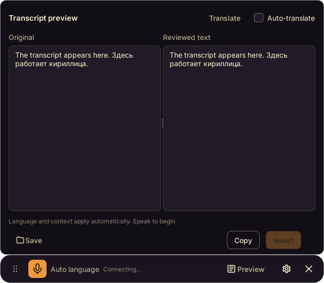

<p align="center">
  
</p>

<p align="center">
  <strong>Speak into the app you are already using.</strong><br>
  A compact Windows dictation panel and a local speech API. Recognition, correction, translation and voice playback run on your machine.
</p>

<p align="center">
  <a href="docs/getting-started.md"></a>
  <a href="docs/api.md"></a>
  <a href="#support-the-project"></a>
</p>

<p align="center">
  <a href="#dictate-without-breaking-your-flow">How it works</a> ·
  <a href="#what-is-included">Features</a> ·
  <a href="#run-from-source">Setup</a> ·
  <a href="docs/architecture.md">Architecture</a> ·
  <a href="ROADMAP.md">Roadmap</a> ·
  <a href="docs/ru/README.md">Русский</a>
</p>

<p align="center">
  
  
  
  <a href="LICENSE"></a>
</p>

## Dictate without breaking your flow

Focus a text field and press **Ctrl+Alt+D**. Speak normally. Completed text enters that field after any enabled correction or translation. Pauses finish utterances while the microphone keeps running. Press the shortcut again to finish the remaining audio and pending work.

Want to review first? Use **Ctrl+Alt+R**. The second press stops recording, waits for processing, and opens Preview. Edit the result and choose **Insert** when it is ready. Insertion never presses Enter or sends the message.

<p align="center">
  
</p>

_Actual Qt widgets with sample text. The toolbar and Preview remain frameless._

| Shortcut | Action |
|---|---|
| `Ctrl+Alt+D` | Start or stop Quick Dictation; insert completed text automatically |
| `Ctrl+Alt+R` | Start or stop dictation with Review; confirm insertion in Preview |
| `Ctrl+Alt+S` | Save reviewed text to the configured Markdown folder |

## What is included

- **Continuous dictation.** Silero VAD separates utterances. Final results stay ordered while later audio is recorded. Partial recognition is for preview only.
- **Correction and translation.** Process completed sentences locally. English and Russian are selected from the text. One editable context document supplies terminology to recognition and text processing.
- **A review editor.** Compare original and processed text, accept or reject corrections, and make manual edits. Late results preserve your edits.
- **Remembered-target insertion.** Reuse Windows UI Automation and clipboard paste. Insert only new text, keep failed results for retry, and retain documents across silence resets.
- **Voice playback and profiles.** Speak typed text, save WAV audio, and record or import a reference for local voice cloning. English and Russian can use different profiles.
- **A separate service.** Use transcription, synthesis, text processing and chat endpoints without opening the panel. A server tray indicator manages the local service.
- **Local records.** Save original text, processed text, translations and reviewed output as Markdown. Voice references and preferences stay local.

## Run from source

The public repository contains source code. Models, inference engines, Qt, ONNX Runtime and private voice samples are separate downloads. It is not a self-contained Windows installer.

**Desktop requirements:** Windows 11 x64, Python 3.11–3.12, Visual Studio 2022 with Desktop development with C++, CMake/Ninja, Qt 6.8.3 for MSVC 2022, ONNX Runtime 1.20.1 and the Silero VAD model. Recognition and text processing also need the selected engines and model files.

1. Clone the repository and prepare the dependencies and runtime files described in [Getting started](docs/getting-started.md).
2. Copy the sample configuration and select the model and engine paths you installed.
3. Build the panel, start the service, and open the panel.

```powershell
git clone https://github.com/Flodirka/VoicePanel.git
cd VoicePanel
python -m pip install --only-binary=:all: --require-hashes -r service/requirements.lock
Copy-Item config.example.yaml config.yaml

# After preparing Qt, ONNX Runtime, engines and models:
.\tools\build_panel.ps1
.\tools\start-service.ps1
.\tools\start-panel.ps1
```

Main recognition and text processing default to CPU. The optional cloning helper in the sample configuration uses CUDA. Disable that helper or configure its paths before using cloned voices on a machine without CUDA. See [CPU and GPU configuration](docs/compute-profiles.md).

## Local speech API

The default address is `http://127.0.0.1:8080`. Selected endpoints use OpenAI-compatible request shapes; VoicePanel does not claim complete OpenAI API compatibility.

| Endpoint | Purpose |
|---|---|
| `POST /v1/audio/transcriptions` | Transcribe uploaded audio |
| `POST /v1/audio/speech` | Generate speech, including configured voice profiles |
| `POST /v1/text/process` | Correct or translate text |
| `POST /v1/chat/completions` | Call the configured local LLM |
| `GET /v1/models` | List configured models |
| `GET /v1/capabilities` | Inspect available capabilities |
| `GET /health` | Check service health |

Voice profile and process-control endpoints are documented in the [API reference](docs/api.md). Keep the service on loopback for normal panel use. See [Security](SECURITY.md) before exposing it to other machines.

## Privacy and practical limits

The default local configuration runs inference on your machine. Downloads require a network connection. Choosing an external text-processing endpoint sends the corresponding text and context to that endpoint. Clipboard insertion temporarily uses the system clipboard and restores it when possible. Optional Markdown records and voice references are local files; transcript logging is disabled by default.

Windows 11 is the tested desktop platform. Other desktop platforms are not supported by the current panel. Standard Notepad insertion is verified; specialized or elevated fields may reject Windows input. Copy remains available. Processing speed depends on the model, engine and hardware. Real CPU inference is not a guarantee of real-time transcription.

## Development and verification

```powershell
python -m pip install pytest==9.1.1
python -m pytest tests -q
.\tools\build_panel.ps1
ctest --test-dir panel/build --output-on-failure
```

Model-free service and security tests run in GitHub Actions. Desktop, microphone, target-field insertion and real-model tests are separate checks. See [Testing](docs/testing.md) for the commands and acceptance steps. Keep all recordings, local logs and internal verification reports outside the public repository.

The repository keeps the application paths explicit:

```text
panel/       C++20 / Qt desktop panel and Windows integration
service/     Python speech service and backend adapters
tests/       Model-free service tests
tools/       Build, download, start and verification scripts
docs/        Setup, architecture, API and verification notes
assets/      README visuals and screenshots
licenses/    Third-party license and attribution files
```

See [Contributing](CONTRIBUTING.md) for development scope and verification expectations.

## Credits and license

VoicePanel builds on [audio.cpp](https://github.com/0xShug0/audio.cpp), [llama.cpp](https://github.com/ggml-org/llama.cpp), [whisper.cpp](https://github.com/ggml-org/whisper.cpp), [Silero VAD](https://github.com/snakers4/silero-vad), Qt and ONNX Runtime. Its continuous voice workflow and speech pipeline were informed by [Pithagoras](https://github.com/thecodacus/pithagoras).

Original VoicePanel code is licensed under [MIT](LICENSE). Attributed adaptations, fonts, icons, engines and model weights retain their own terms. Read [Third-party notices](THIRD_PARTY_NOTICES.md). Runtime binaries and model weights are not included in this repository.

## Support the project

If VoicePanel is useful to you, you can support the time spent building and maintaining it.

<p align="center">
  <a href="https://boosty.to/gdview_gdbrain/donate"></a>
  <a href="https://dalink.to/flodirka"></a>
  <a href="https://www.patreon.com/15806620/join"></a>
</p>

Support is voluntary. These links open external services. See [Support](SUPPORT.md).

[README asset notices](assets/readme/NOTICES.md) · Inter and Lucide.
