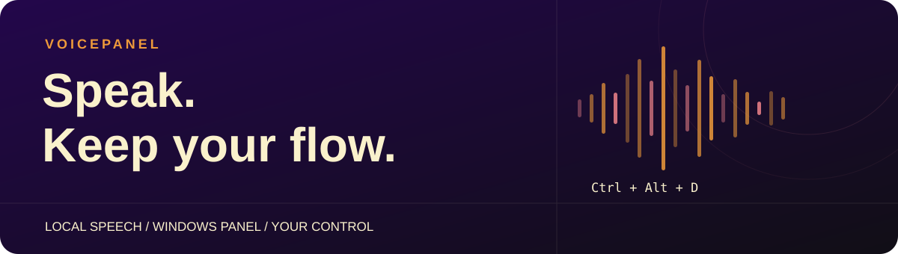
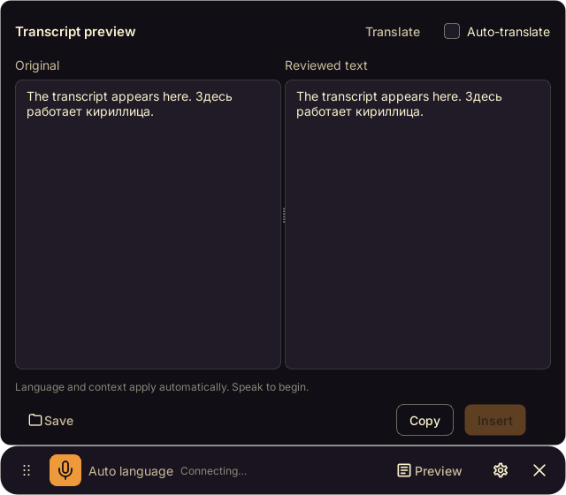

<p align="center">
  
</p>

<p align="center">
  <strong>Speak into the app you are already using.</strong><br>
  A compact Windows dictation panel and a local speech API. Recognition, correction, translation and voice playback run on your machine.
</p>

<p align="center">
  <a href="docs/getting-started.md"></a>
  <a href="docs/api.md"></a>
  <a href="#support-the-project"></a>
</p>

<p align="center">
  <a href="#dictate-without-breaking-your-flow">How it works</a> ·
  <a href="#what-is-included">Features</a> ·
  <a href="#run-from-source">Setup</a> ·
  <a href="#models">Models</a> ·
  <a href="docs/architecture.md">Architecture</a> ·
  <a href="ROADMAP.md">Roadmap</a> ·
  <a href="docs/ru/README.md">Русский</a>
</p>

<p align="center">
  
  
  
  <a href="LICENSE"></a>
</p>

## Dictate without breaking your flow

Focus a text field and press **Ctrl+Alt+D**. Speak normally. Completed text enters that field after any enabled correction or translation. Pauses finish utterances while the microphone keeps running. Press the shortcut again to finish the remaining audio and pending work.

Want to review first? Use **Ctrl+Alt+R**. The second press stops recording, waits for processing, and opens Preview. Edit the result and choose **Insert** when it is ready. Insertion never presses Enter or sends the message.

<p align="center">
  
</p>

_Actual Qt widgets with sample text. The toolbar and Preview remain frameless._

| Shortcut | Action |
|---|---|
| `Ctrl+Alt+D` | Start or stop Quick Dictation; insert completed text automatically |
| `Ctrl+Alt+R` | Start or stop dictation with Review; confirm insertion in Preview |
| `Ctrl+Alt+S` | Save reviewed text to the configured Markdown folder |

## What is included

- **Continuous dictation.** Silero VAD separates utterances. Final results stay ordered while later audio is recorded. Partial recognition is for preview only.
- **Correction and translation.** Process completed sentences locally. English and Russian are selected from the text. One editable context document supplies terminology to recognition and text processing.
- **A review editor.** Compare original and processed text, accept or reject all current corrections in one click, and make manual edits. Late results preserve your edits.
- **Remembered-target insertion.** Reuse Windows UI Automation and clipboard paste. Insert only new text. Failed insertion does not lock recording or silence reset; History keeps earlier text and insertion progress for retry.
- **Voice playback and profiles.** Speak typed text, save WAV audio, and record or import a reference for local voice cloning. English and Russian can use different profiles.
- **Live sessions.** An interpreter window with the call and the microphone side by side, a meeting window with Notes and Transcript tabs, and a subtitles overlay for any application. Captions arrive in order from the microphone, the call or both, and stopping a meeting auto-saves one Markdown file.
- **A separate service.** Use transcription, synthesis, text processing and chat endpoints without opening the panel. A server tray indicator manages the local service.
- **Local records.** Save original text, processed text, translations and reviewed output as Markdown. Voice references and preferences stay local.

## Run from source

The public repository contains source code. Models, inference engines, Qt, ONNX Runtime and private voice samples are separate downloads. It is not a self-contained Windows installer.

**Desktop requirements:** Windows 11 x64, Python 3.11–3.12, Visual Studio 2022 with Desktop development with C++, CMake/Ninja, Qt 6.8.3 for MSVC 2022, ONNX Runtime 1.20.1 and the Silero VAD model. Recognition and text processing also need the selected engines and model files.

1. Clone the repository and prepare the dependencies and runtime files described in [Getting started](docs/getting-started.md).
2. Copy the sample configuration and select the model and engine paths you installed.
3. Build the panel, start the service, and open the panel.

```powershell
git clone https://github.com/Flodirka/VoicePanel.git
cd VoicePanel
python -m pip install --only-binary=:all: --require-hashes -r service/requirements.lock
Copy-Item config.example.yaml config.yaml

# After preparing Qt, ONNX Runtime, engines and models:
.\tools\build_panel.ps1
.\tools\start-service.ps1
.\tools\start-panel.ps1
```

Main recognition and text processing default to CPU. Cloned-voice TTS runs on
the omnivoice.cpp engine (OmniVoice 0.6B Q8_0, ~945 MB, 600+ languages); the
panel's compute switch can place it, recognition and text processing on CUDA —
that is the real-time mode for calls and the live interpreter. The
sample configuration keeps the larger `qwen3-tts-clone` (audio.cpp, GPU
helper) as a documented alternative. See [CPU and GPU configuration](docs/compute-profiles.md).

## Models

VoicePanel ships no weights: you download the models you want and point the
config at them. The tested set, measured speed on the reference hardware, and
per-slot swap instructions live in [Models](docs/models.md). Summary:

| Slot | Tested default | Size | Alternatives |
|---|---|---|---|
| Recognition | `nemotron-3.5-asr-streaming-0.6b` Q8_0 (RTF 0.41–0.46 CPU) | 931 MB | whisper small/large (timestamps) |
| Built-in voices | Piper `ruslan` (male) / `irina` (female) for Russian, Kokoro for English | 62–190 MB | any GGUF Piper voice |
| Cloned voice | OmniVoice 0.6B Q8_0 via omnivoice.cpp — RTF 1.9–6.9 on a (busy) RTX 4060, 13–24 on CPU | 945 MB | qwen3-tts-clone (2 GB, ru/en, GPU helper) |
| Correction | Qwen3.5-0.8B-GEC Q4_0 (skips clean sentences) | 563 MB | any instruct LLM llama.cpp serves |
| Translation | PLaMo 3 Translate 0.8B Q4_K_M | 573 MB | Hy-MT2-1.8B (Apache-2.0) |
| Speaker separation | nemotron-3-diarization Q8_0 | 107 MB | — |

Bigger models work the same way: a slot takes whatever GGUF its engine loads.
Note the license terms — OmniVoice weights are CC-BY-NC 4.0, so they are a
download, never a bundled artifact.

## Local speech API

The default address is `http://127.0.0.1:8080`. Selected endpoints use OpenAI-compatible request shapes; VoicePanel does not claim complete OpenAI API compatibility.

| Endpoint | Purpose |
|---|---|
| `POST /v1/audio/transcriptions` | Transcribe uploaded audio |
| `POST /v1/audio/speech` | Generate speech, including configured voice profiles |
| `POST /v1/text/process` | Correct or translate text |
| `POST /v1/chat/completions` | Call the configured local LLM |
| `GET /v1/models` | List configured models |
| `GET /v1/capabilities` | Inspect available capabilities |
| `GET /health` | Check service health |

Voice profile and process-control endpoints are documented in the [API reference](docs/api.md). Keep the service on loopback for normal panel use. See [Security](SECURITY.md) before exposing it to other machines.

## Sending your voice into another application

Dictation and call listening need no extra software: the panel captures the
microphone, and a call either per application (Windows 10 2004 or newer) or per
output device.

Sending the **translated voice** to a call is the one case that needs a driver:
a capture endpoint other programs can pick as a microphone cannot be created
from user mode. You need a *pair* of endpoints — one playback, one recording —
from any virtual audio cable.

You may already have one. Audio-interface software installs pairs like
`Chat Output → Chat Input` (Maono Arena) or `Virtual Output → Stream Input`;
check the Windows **Recording** tab for a matching input before installing
anything. Otherwise use [VB-CABLE](https://vb-audio.com/Cable/) (free driver,
restart Windows once), which adds `CABLE Input` and `CABLE Output`.

1. In VoicePanel → **Live** → **Settings**, set **My voice goes to** to the
   cable's *playback* endpoint (`Chat Output (Maono Arena)`, `CABLE Input`, …).
2. In the call application, choose the *recording* endpoint of the same cable
   as its microphone (`Chat Input (Maono Arena)`, `CABLE Output`, …).

VoicePanel does not bundle or redistribute any cable driver. The full
walk-through, including how to verify the routing with **Preview**, is in
[Getting started](docs/getting-started.md#6-sending-the-translated-voice-into-a-call-optional).

## Privacy and practical limits

The default local configuration runs inference on your machine. Downloads require a network connection. Choosing an external text-processing endpoint sends the corresponding text and context to that endpoint. Clipboard insertion temporarily uses the system clipboard and restores it when possible. Voice references and Markdown records are local files. Panel auto-save is enabled by default and uses your selected folder, or `transcripts` under VoicePanel's local application-data directory when no folder is selected. Disable auto-save to prevent automatic transcript-file writes. Unsaved History remains in memory until the panel exits. Service transcript logging is disabled by default.

Windows 11 is the tested desktop platform. Other desktop platforms are not supported by the current panel. Standard Notepad insertion is verified; specialized or elevated fields may reject Windows input. Copy remains available. Processing speed depends on the model, engine and hardware. Real CPU inference is not a guarantee of real-time transcription.

## Development and verification

```powershell
python -m pip install pytest==9.1.1
python -m pytest tests -q
.\tools\build_panel.ps1
ctest --test-dir panel/build --output-on-failure
```

Model-free service and security tests run in GitHub Actions. Desktop, microphone, target-field insertion and real-model tests are separate checks. See [Testing](docs/testing.md) for the commands and acceptance steps. Keep all recordings, local logs and internal verification reports outside the public repository.

The repository keeps the application paths explicit:

```text
panel/       C++20 / Qt desktop panel and Windows integration
service/     Python speech service and backend adapters
tests/       Model-free service tests
tools/       Build, download, start and verification scripts
docs/        Setup, architecture, API and verification notes
assets/      README visuals and screenshots
licenses/    Third-party license and attribution files
```

See [Contributing](CONTRIBUTING.md) for development scope and verification expectations.

## Credits and license

VoicePanel builds on [audio.cpp](https://github.com/0xShug0/audio.cpp), the [OmniVoice](https://github.com/k2-fsa/OmniVoice) engine (omnivoice.cpp, built from source), [llama.cpp](https://github.com/ggml-org/llama.cpp), [whisper.cpp](https://github.com/ggml-org/whisper.cpp), [Silero VAD](https://github.com/snakers4/silero-vad), Qt and ONNX Runtime. Its continuous voice workflow and speech pipeline were informed by [Pithagoras](https://github.com/thecodacus/pithagoras).

Original VoicePanel code is licensed under [MIT](LICENSE). Attributed adaptations, fonts, icons, engines and model weights retain their own terms. Read [Third-party notices](THIRD_PARTY_NOTICES.md). Runtime binaries and model weights are not included in this repository.

## Support the project

If VoicePanel is useful to you, you can support the time spent building and maintaining it.

<p align="center">
  <a href="https://boosty.to/gdview_gdbrain/donate"></a>
  <a href="https://dalink.to/flodirka"></a>
  <a href="https://www.patreon.com/15806620/join"></a>
</p>

Support is voluntary. These links open external services. See [Support](SUPPORT.md).

[README asset notices](assets/readme/NOTICES.md) · Inter and Lucide.
