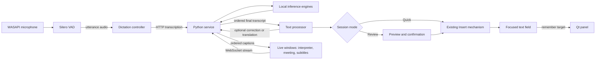

# Architecture

VoicePanel has two independently running components. The Qt panel owns Windows interaction. The Python service owns model routing and backend process management.

## Desktop panel

`panel/src/app/PanelApp.cpp` assembles the application. `MainWindow` owns session mode, preview state, insertion progress and saved records. `HotkeyManager` receives Windows hotkey messages. `FocusTracker` remembers the target; `TextInserter` handles UI Automation and clipboard fallback.

`DictationController` keeps microphone capture and Silero VAD running between utterances. It orders final recognition responses. `TextProcessor` queues stable sentences for correction or translation and keeps incomplete tails. Stop drains recognition before finishing text processing. A finalizing session ignores another start request.

Quick mode inserts completed output incrementally. Review mode waits for explicit confirmation. Only successful insertion advances insertion progress. Silence rollover waits for recognition and text processing, preserves the completed quick document in History, and clears the panes without closing capture. Failed insertion or storage does not block recording or rollover. Restoring History restores the remembered target and insertion progress, so a retry sends only the remaining suffix.

Auto-save writes stable transcripts, processing results and reviewed edits independently of insertion. With auto-save enabled and no custom folder, `Settings::transcriptDirectory()` selects the local application-data directory under `transcripts`. Disabling auto-save prevents automatic writes. Unsaved History exists only in memory until the panel exits.

`TtsPlayer` queues synthesis ahead of playback and can write combined speech to WAV. `MarkdownStore` writes session records. Settings and voice references stay outside the public source tree.

`SessionController` owns live sessions. The interpreter window splits the call and the microphone into two halves with per-source level badges, the meeting window keeps Notes and Transcript tabs, and the subtitles overlay shows a compact caption card over any application. `WasapiCapture` captures the microphone and, on Windows 10 2004+, process loopback audio. Session state lives on the absolute session clock, so the diariser's rolling buffer cannot drift speaker labels. Stopping a meeting auto-saves one Markdown file with the Notes section first and the Transcript second; manual save prefills the same name.

## Python service

`service/voiceservice/app.py` creates the FastAPI application. `api/` contains HTTP and WebSocket routes. `backends/` adapts audio.cpp, llama.cpp, whisper.cpp and omnivoice.cpp. `compute.py` handles persisted compute choices per group (`main`, `llm`, `clone`, diarization). `voices.py` stores local voice profiles.

Live transcription streams over `ws://…/v1/sessions/dictation`: the server rechunks binary PCM into VAD frames and returns ordered partials, finals and diarisation tags. `POST /v1/warmup` loads the ASR model if it is not resident and prefills the local text model's prompt prefix before a session starts; it never touches an external text server. A stored voice profile whose clone engine is no longer configured resolves to a served model, so older profiles keep working after a config change.

The service exposes health and capability endpoints separately from inference. Backend processes and models are loaded on demand according to configuration. The default setup uses local endpoints. Configuring an external LLM changes where text and context are sent.

## Data and runtime files

`config.example.yaml` is the public template. `config.yaml`, `runtime/`, downloads, voice references, saved transcripts and build trees are local. They are excluded from version control. Third-party engine and model licenses remain separate from VoicePanel's original source license.
