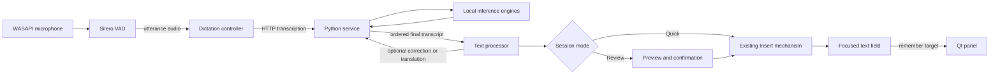

# Architecture

VoicePanel has two independently running components. The Qt panel owns Windows interaction. The Python service owns model routing and backend process management.

## Desktop panel

`panel/src/app/PanelApp.cpp` assembles the application. `MainWindow` owns session mode, preview state, insertion progress and saved records. `HotkeyManager` receives Windows hotkey messages. `FocusTracker` remembers the target; `TextInserter` handles UI Automation and clipboard fallback.

`DictationController` keeps microphone capture and Silero VAD running between utterances. It orders final recognition responses. `TextProcessor` queues stable sentences for correction or translation and keeps incomplete tails. Stop drains recognition before finishing text processing. A finalizing session ignores another start request.

Quick mode inserts completed output incrementally. Review mode waits for explicit confirmation. Only successful insertion advances insertion progress. Silence rollover saves a completed quick document before clearing its panes; pending work, unavailable storage and failed insertion prevent destructive resets.

`TtsPlayer` queues synthesis ahead of playback and can write combined speech to WAV. `MarkdownStore` writes session records. Settings and voice references stay outside the public source tree.

## Python service

`service/voiceservice/app.py` creates the FastAPI application. `api/` contains HTTP and WebSocket routes. `backends/` adapts audio.cpp, llama.cpp and whisper.cpp. `compute.py` handles persisted backend compute choices. `voices.py` stores local voice profiles.

The service exposes health and capability endpoints separately from inference. Backend processes and models are loaded on demand according to configuration. The default setup uses local endpoints. Configuring an external LLM changes where text and context are sent.

## Data and runtime files

`config.example.yaml` is the public template. `config.yaml`, `runtime/`, downloads, voice references, saved transcripts and build trees are local. They are excluded from version control. Third-party engine and model licenses remain separate from VoicePanel's original source license.
